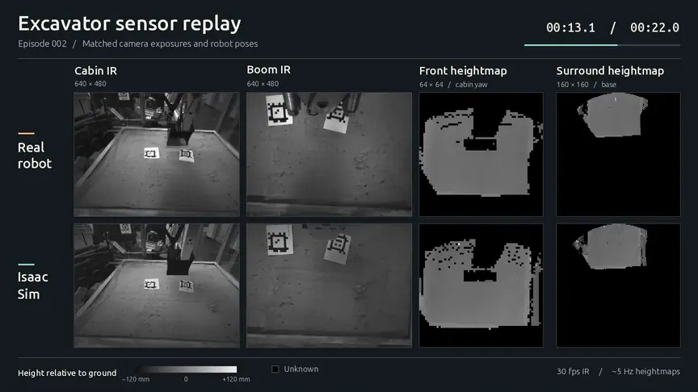

# Sim scratchpad

(slop README, I'll prune this later. As of now only the soil simulation integration is missing, performance measured without it...)

**30 Hz IR and 5 Hz heightmaps in RViz** on an NVIDIA GeForce RTX 5070 Laptop GPU (75 W maximum).
In a 25-second headless Isaac Sim replay at real-time speed with RViz open, a local ROS
subscriber measured **29.95 Hz per IR camera** and **5.00 Hz for both heightmaps and the
green terrain cloud**. Isaac rendered cabin and boom IR at 224×168 and processed both
320×240 depth cameras locally, including robot self-filtering, FastDEM fusion, ROS 2 and TF.
The sand surface was static. Uncheck **FastDEM accumulated terrain** in RViz to stop
receiving the cloud on that machine.
[Performance journal and pre-soil baseline](DEVELOPING.md#gamepad-and-live-rviz-sensor-rates)

## Real robot and Isaac Sim

[](media/excavator-sensor-replay.mp4?raw=true)

[Watch the 22-second comparison (MP4)](media/excavator-sensor-replay.mp4?raw=true).
The top row shows episode 002 from the real excavator. The bottom row replays its measured poses
in the scanned room. For this video, both IR views are 640×480 and each simulated camera uses its
own recorded exposure time. The front and surround maps update on the recording’s depth timestamps.
Both rows use the same height scale, with gray at ground level and black for unknown cells.
Across the 110 visible map updates, the median absolute height difference was **5 mm**
on cells observed by both systems in each map. Known-cell overlap (intersection over
union) was 88% for the front and 89% for the surround.

## Getting started

Place this checkout at `IsaacLab/scripts/sim-scratchpad` and use Isaac Lab's
Python environment. Run `git lfs install` before cloning or `git lfs pull` in
an existing checkout to fetch the room scan.
The scan is stored at `assets/3dgs_40k_1m_sh3.usdz`; `demo_env.usd` references it
relative to this checkout.

For development, start with [DEVELOPING.md](DEVELOPING.md): pipeline ownership,
simulated-sand integration points, tests and output locations. Shared robot
geometry lives in [assets/urdf/](assets/urdf/README.md); generated experiments
belong in [logs/](logs/README.md).

- Open `demo_env.usd` in Isaac Sim for the registered room splat and calibrated
  cabin and arm cameras. [IR capture, replay, and calibration](camera_calibration/README.md)
- Run `uv run --no-sync python sensor_demo/demo.py --view soil` for the Newton
  soil demo. Its ROS launcher publishes the ground-truth heightmap, and
  `sensor_demo/collect.sh` records expert episodes through `ros-excavator`.
  [Newton demo and data collection](sensor_demo/README.md)
- Both RTX lidar mounts are already in `demo_env.usd`. The [scan reader](ros2/sim_lidar.py)
  can be used from Kit, and the [lidar prototype](lidar_demo_script.py) shows how
  to filter robot self-hits.

## 3DGS viewer

Run from this checkout using Isaac Lab's existing environment, including its
`isaacsim` extra. On this Windows setup, Isaac Sim 6.2 and the room scan are
already installed; `--no-sync` reuses that environment.
The launcher shares the desktop application's versioned shader caches under
`%LOCALAPPDATA%/ov/cache/shaders` instead of rebuilding them in Kit's portable cache.

```powershell
uv run --no-sync python launch_3dgs.py
uv run --no-sync python launch_3dgs.py --camera cabin
uv run --no-sync python launch_3dgs.py --camera arm
```

The viewer opens `demo_env.usd` with the registered Gaussian splat, excavator,
and calibrated cameras. Physics starts paused. Use the viewport camera menu to
switch views and close the window to exit. Camera changes stay in the session
layer unless you explicitly save the scene.

Save a viewport image, or render a fixed number of frames without a window:

```powershell
uv run --no-sync python launch_3dgs.py --snapshot logs/3dgs/overview.png
uv run --no-sync python launch_3dgs.py --headless --frames 120 --camera cabin --snapshot logs/3dgs/cabin.png
```

### Heightmaps with gamepad control or replay

From `sim-scratchpad`, set `KAIVURI_REPO` to your local `kaivuriprokkis`
checkout and start the non-ROS gamepad demo. Replace the example path with yours.

```bash
export KAIVURI_REPO="/path/to/kaivuriprokkis"
uv run --no-sync python launch_3dgs.py --mode gamepad
```

The export lasts for the current shell. Add it to `~/.bashrc` to reuse it in
new Bash sessions. In PowerShell, use `$env:KAIVURI_REPO = "C:\path\to\kaivuriprokkis"`.

The demo imports the robot's depth projection and arm filtering code from that
checkout so the simulator uses the same mapping logic as the excavator. FastDEM
accumulates the surrounding terrain map. The launcher checks scratchpad builds
first, then looks for `fastdem_replay` (`.exe` on Windows) under
`$KAIVURI_REPO/native_stack/tools/heightmap_bench/`. If you need to build it,
follow the [FastDEM setup instructions](DEVELOPING.md#run-on-another-computer).
Use `--robot-repo PATH` or `--fastdem PATH` to override discovery for one run.

The same setup supports recorded motion and gamepad control with direct joint speeds.

```sh
uv run --no-sync python launch_3dgs.py --mode replay
uv run --no-sync python launch_3dgs.py --mode gamepad --nodynamics
```

This uses the checked-in [camera/filter profile](config/heightmaps/README.md) and
[motion sample](assets/motions/README.md). No recorded dataset or files from
`logs/` are needed. It shows cabin/boom IR views at 224x168 (the original 4:3 field
of view), a 64x64 front map and a 160x160 surrounding FastDEM map. Viewport 1 is
disabled. Depth resolution is independent of IR resolution.
Open `demo_env.usd` in Isaac Sim to inspect the full environment, or use
`--show-viewport` for a performance comparison. `--ir-width` changes the IR render size.
Use `--depth-maps` instead of `--mode replay`
for a stationary scene, or `--replay PATH` for another saved motion.

Gamepad mode loads the arm and slew MLPs from the sibling `Isaac-hydraulic-actuator`
checkout; set `--actuator-repo PATH` or `HYDRAULIC_ACTUATOR_REPO` elsewhere. The
arm model includes carriage pitch. Left stick X/Y controls slew/tilt, right stick
Y/X controls lift/bucket, and B or keyboard R resets pose, model history and maps.
`--nodynamics` uses direct joint speeds. Replay always reproduces saved poses exactly.

The models run on a separate CPU worker with fixed 10 ms steps. Rendering cannot
stretch their history timestep; long scheduling stalls are reported as dropped
wall time. Motion is integrated into USD for free-space operation; contact and
digging loads are not modeled. The live panel targets 30 Hz for both IR views
and 5 Hz for both maps. Each map uses the IR exposure's applied robot pose.
The panel reports the achieved rates independently. `control_performance.json`
under `--depth-out` includes the measured sensor periods and hydraulic timing.

The bundled live demo defaults to 320×240 depth. Use `--depth-divisor 1` for
native 640×480, `2` for 320×240 or `4` for
160×120 with the bundled calibration. The renderer and robot projector use
scaled intrinsics. The default robot profile projects a 160×120 grid per
camera in all three cases. The front and surround map cell sizes stay fixed.

`--config PATH` selects another simulator profile; `--dataset PATH` explicitly
uses recorded calibration and the robot checkout's current policy for comparisons.
[Calibration, launch commands, exports and filter experiments](DEPTH_MAPPING.md).

Run the ROS launcher from the simulator terminal for a headless replay with
both IR cameras, heightmaps, and the robot in RViz.

```sh
export ROS_DOMAIN_ID=42
bash ros2/run_latest.sh --headless --mode replay --ros-cameras --ir-width 224 --ros-time wall
```

In a second terminal, source your system ROS 2 installation and launch
`ros2 launch ./ros2/view_latest.launch.py` on the same domain with Fast DDS.
For gamepad input and the same RViz streams, run
`bash ros2/run_latest.sh --mode gamepad --ros-cameras` with the controller
connected to Kit. The replay streams until stopped. Add `--frames N` for a finite run.
[RViz terminal setup and ROS topics](ros2/LATEST.md#ubuntu-setup-and-launch).

The excavator USD comes from
[Isaac-hydraulic-actuator at 4775a97](https://github.com/eetmie/Isaac-hydraulic-actuator/tree/4775a97)
and retains its [Apache 2.0 license](assets/excavator_bucket.LICENSE). The NVIDIA
SimReady objects retain their CC BY 4.0 license and attribution metadata in
`assets/simready/`.
